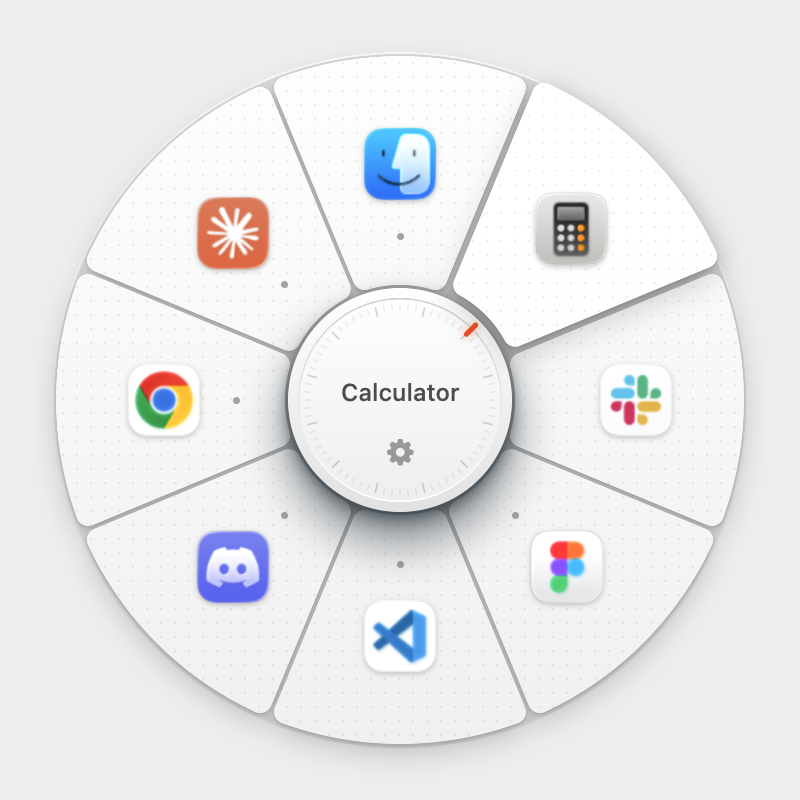

<div align="center">


# Tool Wheel

**A tactile radial launcher for macOS and Windows.**<br>
Hold a shortcut, and your favourite apps fan out around the cursor on a clicky dial.

[](https://github.com/ni3ra5/tool-wheel/releases)


[**⬇ Download from Releases**](https://github.com/ni3ra5/tool-wheel/releases)

<br>



</div>

---

## ✨ Features

- **Appears at your cursor**: hold the shortcut and the wheel opens around the pointer, on any screen.
- **Designed like hardware**: moulded-plastic slices and a knob that turns in 10° detents, with a soft, heavy *thock* on each one.
- **Two ways to launch**: click a slice, or hover it and let go of the shortcut.
- **Shows running apps**: a small dot marks apps that are already open; picking one brings it forward instead of starting another copy.
- **No permissions needed**: the shortcut is read by polling, with no keyboard hook and no Accessibility prompt. (One exception: using a mouse side button as the shortcut on a Mac asks for Accessibility, so the button's Back/Forward can be blocked.)
- **Updates itself**: checks GitHub at launch, asks first, then downloads, verifies and restarts.

## 📦 Install

### macOS

> macOS 14 or later, Apple silicon or Intel (one universal app).

1. Download `ToolWheel-<version>.zip` from [Releases](https://github.com/ni3ra5/tool-wheel/releases) and unzip it.
2. Drag **Tool Wheel.app** into **Applications**.
3. Open it. The app isn't notarized, so macOS blocks the first launch. Go to **System Settings → Privacy & Security**, scroll down and click **Open Anyway**, or run:
   ```bash
   xattr -dr com.apple.quarantine "/Applications/Tool Wheel.app"
   ```
4. Settings opens on first launch. There's no Dock or menu bar icon; open the app again any time to get back to Settings.

### Windows (preview)

> Windows 10 or 11, x64 or ARM64. A single portable `.exe`, no installer.

1. Download `ToolWheel-<version>-win-x64.zip` (or `-win-arm64.zip`) from [Releases](https://github.com/ni3ra5/tool-wheel/releases) and unzip it somewhere permanent.
2. Run **ToolWheel.exe**. If SmartScreen warns about an unrecognised app, choose **More info → Run anyway**.
3. It lives in the system tray. Double-click the icon (or right-click → **Settings…**) to set it up; right-click → **Quit Tool Wheel** to close it.

## 🎛 Using it

| Do this | macOS | Windows |
| --- | --- | --- |
| Open the wheel | Hold **⌃⌥⌘** | Hold **Ctrl+Alt+Win** |
| Launch an app | Hover its slice, then click (or let go of the keys) | same |
| Close without launching | Let go of the keys (with release-to-open on, move off the slices first) | same |
| Open Settings | Click ⚙︎ under the knob, or open the app again | Click ⚙︎ under the knob, or the tray icon |
| Turn the wheel off / on | Your on/off shortcut, if you set one | same |

## ⚙️ Settings

- **Add apps** by searching everything installed.
- **Rearrange** them by dragging the grip beside each slice; **remove** one by holding its trash button.
- **Colour-code** a slot with a band along its outer edge (8 preset colours).
- **Change the shortcut**: two or more modifier keys, or a mouse side button (4 or 5) on its own or with keys. *Restore default* puts it back.
- **On/off shortcut**: modifiers plus one key (e.g. ⌃⌥P / Ctrl+Alt+P) that turns the wheel off and on. None by default.
- **Open apps by** clicking or by releasing the shortcut.
- **Open at login** and **Check for updates at launch**, plus a **Check now** button.

### tools.json

Everything is saved to `tools.json`, which you can also edit by hand:

- macOS: `~/.config/toolwheel/tools.json`
- Windows: `%APPDATA%\ToolWheel\tools.json`

```json
{
  "wheel": [
    { "name": "Safari", "path": "/Applications/Safari.app", "color": "#0A84FF" },
    { "name": "Docs", "path": "https://example.com/docs" }
  ],
  "releaseToOpen": false,
  "checkForUpdates": true
}
```

`path` is usually an app (`.app` on macOS; `.exe` or `.lnk` on Windows, where `%WINDIR%`-style variables work), but any file, folder or URL works too. The shortcut fields (`shortcut`, `mouseButton`, `toggleKey`, `toggleModifiers`) are platform-specific codes, so set those in Settings rather than by hand. If the file can't be read, it's moved aside as `tools.json.invalid` and the defaults are used.

## ⚠️ Known limits

- Shortcuts are modifier keys, optionally with a side button; letter-key shortcuts would need a keyboard hook or extra permissions.
- **Windows:** the shortcut doesn't fire while an admin window (Task Manager, an admin terminal, an installer) is in front, because Windows hides key state from normal apps then.
- **Updates** need write access to the app's folder. A standard (non-admin) Mac user can't write to `/Applications`, so the update fails with a link to the download page instead.
- Downloads aren't code-signed: expect the Gatekeeper / SmartScreen warning above, and a Mac side-button shortcut may need Accessibility granted again after an update.

## 🛠 Build from source

```
mac/        Swift / SwiftUI app (Swift Package, no Xcode project)
windows/    C# / WPF app (.NET 8)
site/       landing page (plain HTML/CSS/JS)
assets/     icon and screenshot
```

**macOS** (Command Line Tools are enough):

```bash
cd mac
swift run                              # debug build
scripts/build-app.sh 1.2.3             # universal dist/Tool Wheel.app + zip (no version = 0.0.0, never updates)
.build/debug/ToolWheel --snapshot out.png   # render the wheel to a PNG
scripts/make-icon.sh                   # re-render the icon for both platforms
```

**Windows:**

```bash
cd windows
dotnet run
```

**Releasing:** push a tag and GitHub Actions builds the downloads, attaches them with a `SHA256SUMS` file (which the in-app updater checks), and the landing page picks up the new version on its own.

- `mac-vX.Y.Z` → `ToolWheel-X.Y.Z.zip`
- `windows-vX.Y.Z` → `ToolWheel-X.Y.Z-win-x64.zip` and `-win-arm64.zip`
